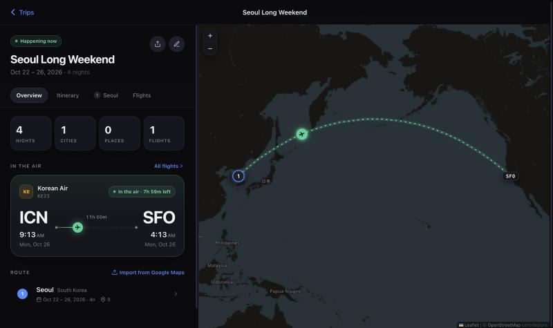
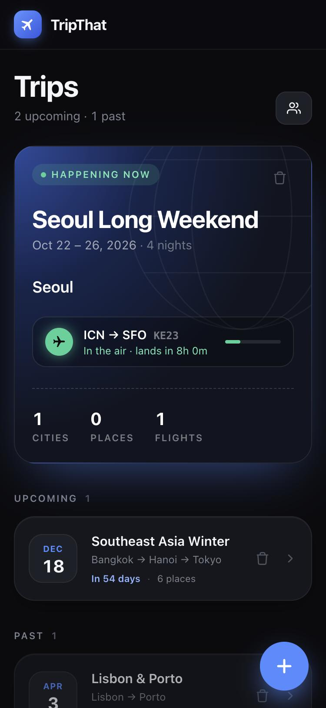
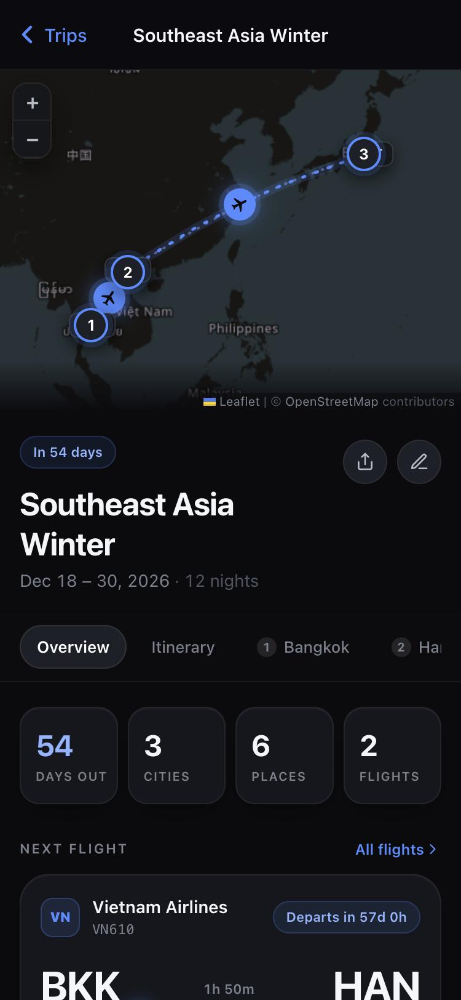
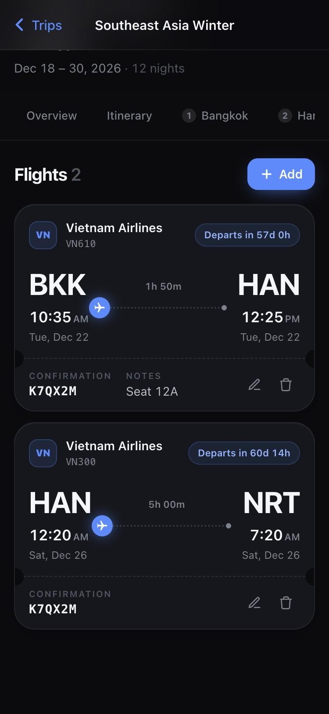

# TripThat

A multi-city trip planner with a dark, flight-tracker-inspired interface. Save the restaurants, sights, and hotels you've researched for each city, line up your flights, and build a day-by-day plan — all on one map.

**Live:** [tripthat.vercel.app](https://tripthat.vercel.app) · installable on your phone's home screen



<p>
  
  
  
</p>

## Features

- **Trips and routes** — create a trip with any number of cities, each with its own dates. Cities are geocoded automatically and drawn on the map in order.
- **Live flight cards** — type a flight number and date to auto-fill the airline, route, and times. Each flight shows a countdown to departure, a progress bar while it's in the air, and next-day / previous-day arrival markers.
- **Flight map** — great-circle flight arcs (correct across the Pacific / antimeridian), animated in the flight's status color, with a plane marker at the flight's current position.
- **Places** — save spots per city by category (Food, Sightseeing, Accommodation, Night Market, Shopping, Other) with status tracking (Want to Go → Confirmed → Done / Skipped), notes, links, and backup flags. Food places add cuisine, price range, and a must-try dish. Paste a Google Maps link to auto-fill a place.
- **Hotels** — check-in / check-out per city, with Google Maps link auto-fill.
- **Itinerary** — a trip-wide timeline that combines flights and plans, plus a per-city day planner where you add saved places or custom activities at set times. Print any day.
- **Google Maps import** — drop exported city CSV lists or a Google Takeout `Saved Places.json`; each place is matched to the right city.
- **Trip sharing** — turn on sharing to get a 6-character code; anyone who joins with it sees changes sync live (needs Supabase, see below).
- **Phone-first** — bottom-sheet forms, sticky tabs, back-gesture support, and installable as a PWA. Data is saved in the browser, so it works without an account.

## Tech stack

| Area | Tools |
| --- | --- |
| Frontend | React 18, Vite, Tailwind CSS, Framer Motion |
| Maps | Leaflet / react-leaflet, OpenStreetMap tiles, Nominatim geocoding |
| Flight data | AeroDataBox (via RapidAPI), called through a Vercel serverless function |
| Sync | Supabase (PostgreSQL + Realtime) |
| Hosting | Vercel, `vite-plugin-pwa` |

The flight lookup runs server-side in [`api/flight-lookup.js`](api/flight-lookup.js), so the RapidAPI key never ships to the browser. During `npm run dev`, Vite serves the same function as middleware.

## Running locally

```bash
npm install
cp .env.example .env   # then fill in the values
npm run dev            # http://localhost:5173
```

### Environment variables

| Variable | Required | Purpose |
| --- | --- | --- |
| `RAPIDAPI_KEY` | For flight lookup | AeroDataBox key from RapidAPI. **Server-only** — no `VITE_` prefix, so it stays out of the client bundle. |
| `VITE_SUPABASE_URL` | For sharing | Your Supabase project URL. |
| `VITE_SUPABASE_ANON_KEY` | For sharing | Your Supabase anon (public) key. |

Everything except flight lookup and sharing works with no keys at all.

### Sharing setup (optional)

Sharing reads and writes a `shared_trips` table in Supabase with these columns, and listens for row updates over Realtime:

| Column | Type |
| --- | --- |
| `share_code` | `text`, primary key |
| `trip_data` | `jsonb` |
| `updated_by` | `text` |
| `updated_at` | `timestamptz` |

Enable Realtime on the table so joined devices receive updates.

## Deploying

The app deploys to Vercel as a static Vite build plus the `api/` function. Set `RAPIDAPI_KEY` (and the Supabase variables if you use sharing) in the Vercel project's environment variables, then:

```bash
vercel --prod
```

## Project structure

```
api/flight-lookup.js        Serverless proxy for AeroDataBox flight lookups
src/context/AppContext.jsx  App state (trips, places, flights, hotels, itinerary) + localStorage
src/hooks/                  useTripSync (Supabase sharing), useNow (live countdowns)
src/components/trips/       Trip list, trip screen, trip form
src/components/flights/     Flight cards, timeline, flight form
src/components/map/         Leaflet map with great-circle arcs
src/components/places/      Place cards, list, form, Google Maps import
src/components/hotels/      Hotel list and form
src/components/itinerary/   Trip timeline and per-city day planner
src/utils/helpers.js        Date, countdown, and formatting helpers
```
